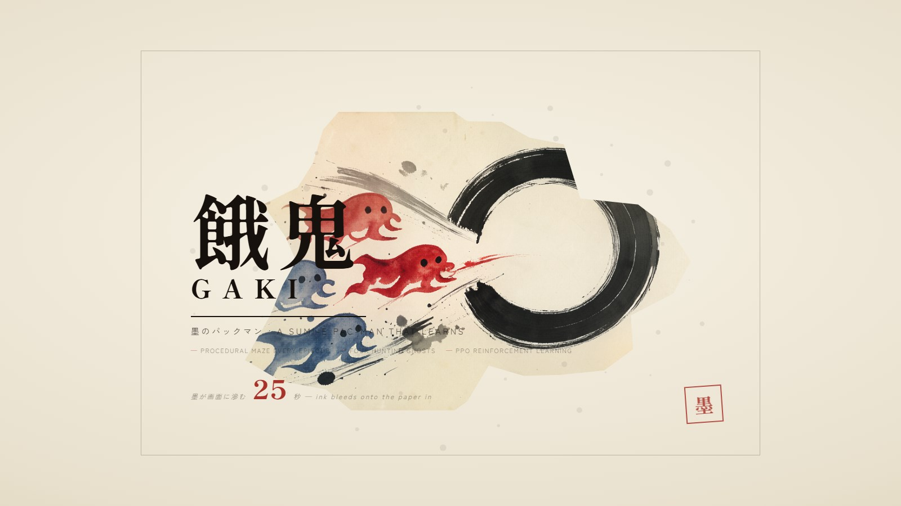
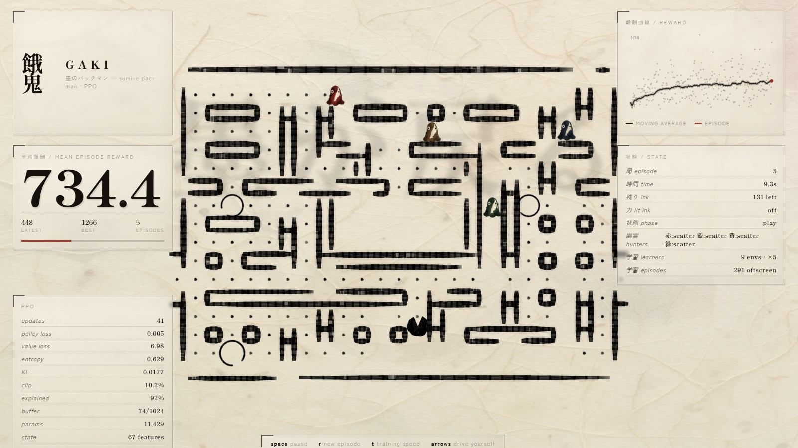
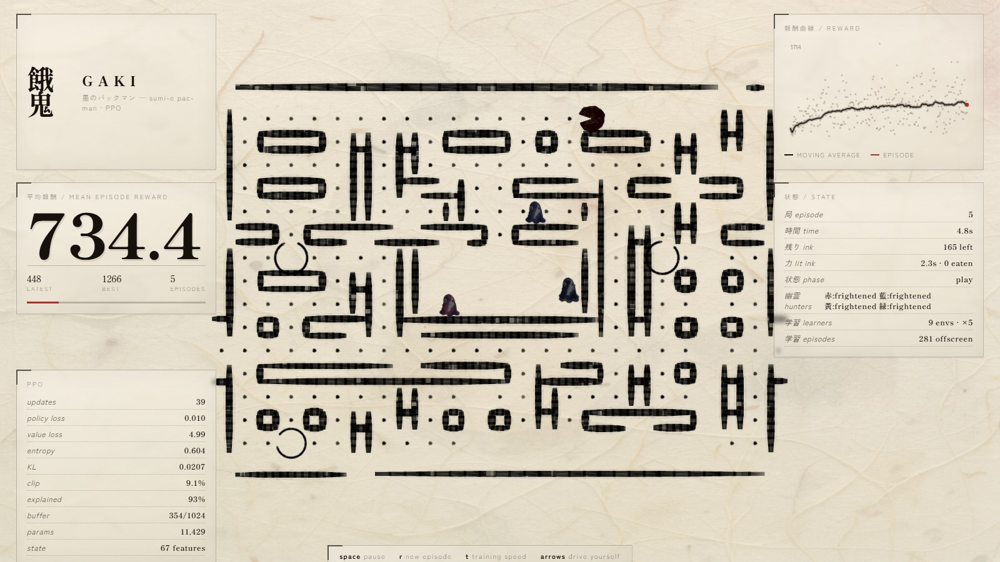
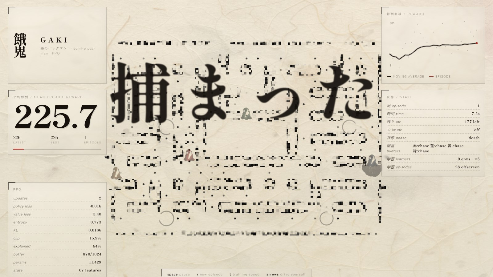
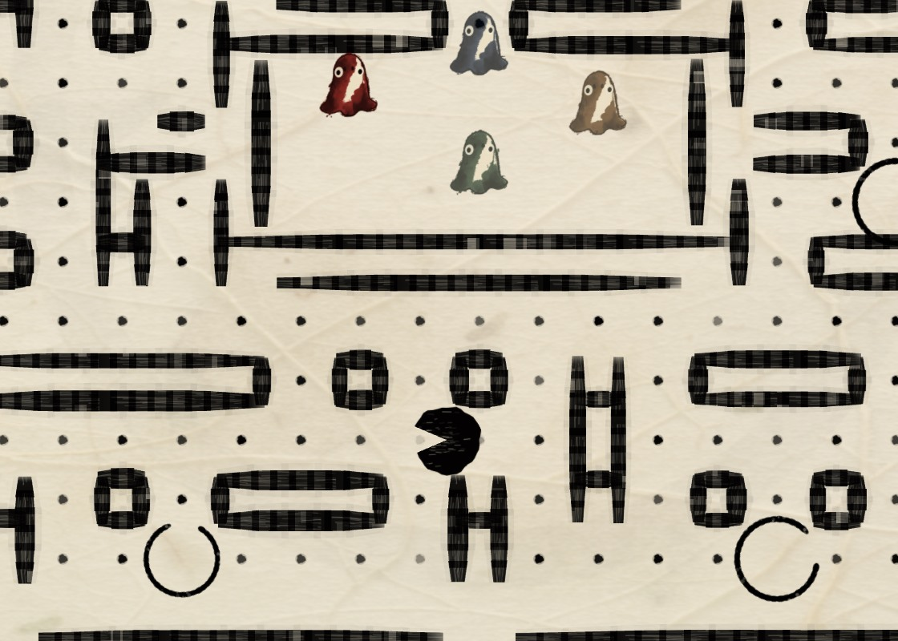

# 餓鬼 GAKI · SUMI-PACMAN

**A sumi-e Pac-Man that learns to play itself.**

One ghost-hunter you can watch, eight more training off-screen, and a single PPO
policy shared between them — all painted in ink on paper, in the browser, with no
build step and no dependencies to install.



```bash
node server.js      # then open http://localhost:8802
```

On Windows you can just double-click **`START.bat`**. Requires Node.js 18+.
Nothing else — three.js is vendored in `vendor/`, the neural net is hand-rolled
in `src/rl/`.

---

## What you are looking at



The maze is regenerated from scratch for every episode, so the policy cannot
memorise a layout — it has to read the walls around it. The four hunters are
always in the same order, always the same temperament, and the ink dots are the
only thing keeping the mouth alive.

The HUD is not decoration. Every number on it comes from the thing running
behind it:

| panel | what it is |
| --- | --- |
| **mean episode reward** | 10-episode moving average of the episode *on screen* |
| **reward curve** | every episode as a pale dot, the moving average as a brush line — the visible run plus all off-screen learners |
| **state** | live episode state: pellets left, lit-ink window, hunter modes, learner count |
| **PPO** | policy/value loss, entropy, KL, clip fraction, explained variance, buffer fill, parameter count |

The episode on screen only ends when that Pac-Man dies or eats the last dot, so
the headline numbers track one continuous lineage rather than an average of
strangers.

### When the ink is lit



Eating a power pellet turns the brush red and every hunter into prey. Each
successive pellet in the same episode buys less time — 6.5 s, then ×0.84 per
window, floored at 1.6 s — and a hunter swallowed inside one window is worth
150, 300, 600, 1200.

### When the ink dissolves



A death does not cut. The maze breaks into speckles, the paper shows through,
and a fresh sheet is painted in a diagonal sweep.

---

## How it learns

There is no pretrained model anywhere in this repo. The policy starts as random
weights and is trained live, in the tab you are looking at.

**The agent** thinks 10 times a second (`CONTROL_DT = 0.1`) on top of a 160 Hz
fixed-step simulation, and picks one of four directions. Walls are removed from
the action distribution before sampling, so it can never ask to walk into one.

**67 features**, all measured from Pac-Man's own body so a brand-new maze is not
a brand-new language:

- 4 open directions, 4 current-heading, 1 "about to reverse", 1 reverse momentum
- shortest-path direction and distance to the nearest pellet, plus pellets visible 1–2 tiles down each corridor
- for each hunter: relative x/y, distance, and whether it is frightened / eaten / home
- BFS danger field per direction — how soon a living hunter can touch him — plus 1/2/4-tile alarms
- BFS *prey* field per direction — how soon a frightened hunter can be bitten
- lit-ink flag and remaining fraction, pellets left, pellets eaten
- junction count, tunnel flag, house flag, starvation timer, tile novelty

**Rewards** are deliberately shaped, because sparse pellets alone teach nothing
in a maze this size:

| event | reward |
| --- | ---: |
| dot | +10 |
| power pellet | +30 |
| hunter eaten | +150 ×2ᵏ |
| all dots eaten | +300 |
| death | −60 |

| shaping, per control tick | reward |
| --- | ---: |
| stepping onto a new tile | +2 |
| re-entering a tile | −0.05 |
| travelling forward | +0.5 |
| undoing the last step | −0.4 |
| pacing a loop | −0.6 |
| starving | −0.1 / tick |

On top of that sit three potential-based nudges (towards the nearest dot, away
from the nearest hunter, towards an edible hunter) that are clamped and switched
off in a panic, so they can point the search without changing what a good policy
wants.

**The learner** is PPO with a clipped surrogate objective, GAE(λ), Adam and a
categorical policy over the four legal directions:

| | |
| --- | --- |
| network | 67 → 96 → 48 → (4 policy logits, 1 value) — 11,429 parameters |
| γ / λ / clip | 0.99 / 0.95 / 0.2 |
| epochs / minibatch | 8 / 32 |
| learning rate | 5e-4 (Adam) |
| rollout buffer | 1,024 transitions, double-buffered |
| entropy | 0.03, decayed ×0.996 per update, floored at 0.004 |
| KL stop | 0.02 |
| reward scale | 0.1 |

The double buffer matters: collection never stops while an update is in flight.
Updates are spread across animation frames (a couple of minibatches per frame),
so the page keeps rendering at speed while the network changes underneath it.

**The ensemble.** One visible episode plus eight headless ones — nine
simulations, one policy. All nine write into the same rollout buffer, so the
visible Pac-Man is trained by seven other mouths' worth of experience every
second. Off-screen learners run at up to 24× real time (press **T**).

---

## The four hunters

They are not the arcade ghosts. Each one runs BFS over the maze graph with a
cached field per target, and each one wants a different thing:

| | name | temperament |
| --- | --- | --- |
| 赤 | **aka** | chases Pac-Man's tile directly |
| 藍 | **ai** | mirrors him through the maze centre |
| 黃 | **ki** | aims four tiles ahead along his heading |
| 緑 | **midori** | *cuts* — picks the tile that shrinks his escape room |

They also refuse to stack on one tile, avoid parking on junctions he can reach,
turn around when walking on only takes them further away, leave the pen on a
schedule tied to pellets eaten, and scatter to their own corner when the phase
timer says so. A frightened hunter does not merely run — it runs towards open
paper, because backing into a dead end is being eaten next tick.

---

## The paper



*Four hunters, one mouth, ink dots and enso pellets — every stroke here is a
tapered shader quad over a procedurally generated brush texture.*

Everything is drawn with three.js in an orthographic scene, but nothing is a
sprite pasted on a background:

- every wall edge facing a corridor becomes a **tapered brush stroke** — a
  custom shader that pinches the ends, wobbles the spine, and breaks the ink
  with long dry-brush streaks along the stroke
- the stroke, dot, enso (power pellet), blot and eye textures are **generated
  procedurally in canvas** at load time (`src/art/textures.js`)
- the maze is *painted* at the start of an episode (a diagonal reveal sweep) and
  *dissolved* at the end (speckles, not a fade)
- the title sheet, the paper grain and the four hunter sprites were generated
  with FLUX from the prompts kept in `assets/prompts/`

---

## Controls

| key | |
| --- | --- |
| **space** | pause / resume |
| **r** | abandon this episode, paint a new maze |
| **t** | cycle off-screen training speed ×1 → ×5 → ×12 → ×24 |
| **arrows / wasd** | take the wheel (the policy is ignored while you drive) |
| **a** | hand it back to the policy |

URL parameters, for when you want a specific frame:

```
?hero=0      skip the title sheet
?speed=24    off-screen learners run 24× real time
?envs=16     more headless learners
?play=2      the visible episode runs at 2×
?reveal=0.5  faster maze painting
?death=3     longer dissolve
```

---

## Repository

```
index.html            HUD, title sheet, import map
styles.css            paper, plates, seals
server.js             zero-dependency static server + live reload
START.bat             Windows launcher

src/main.js           the frame: episode lifecycle, HUD, hero, asset build
src/game/maze.js      procedural maze, BFS fields, invariants
src/game/sim.js       fixed-step simulation + the state/action/reward contract
src/game/ghost-brain.js  four temperaments, cached BFS fields, pen logic
src/rl/net.js         typed-array MLP with Adam, browser and node
src/rl/ppo.js         clipped PPO, GAE, double-buffered rollouts
src/art/              brush-stroke maze, actors, procedural ink textures
src/ui/graph.js       the reward curve
tools/                headless probes used while building it
assets/               generated paper, title and hunter art + their prompts
vendor/               three.js r187 (MIT), vendored so the repo runs offline
```

### Tools

Development probes, all plain node — no framework:

```bash
node tools/maze-test.mjs        # maze invariants: connectivity, house, tunnel, pellets
node tools/maze-debug.mjs       # ASCII dump of a generated maze
node tools/rl-probe.mjs 8 240   # train headless, then compare greedy / stochastic / random
node tools/loop-check.mjs       # does the policy travel, or pace in circles?
node tools/shot.mjs             # screenshot the running page through puppeteer
```

---

## Credits

- [three.js](https://threejs.org/) r187, MIT — vendored in `vendor/`
- Shippori Mincho B1 and Zen Kaku Gothic New, served from Google Fonts
- Title sheet, paper grain and hunter sprites generated with FLUX from
  `assets/prompts/`

The rules of Pac-Man are Namco's. This is a study of a 1980 arcade game's
decision problem, painted differently.
